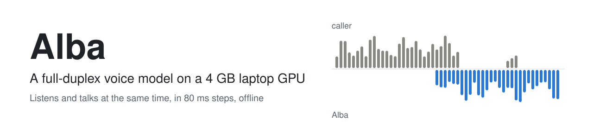
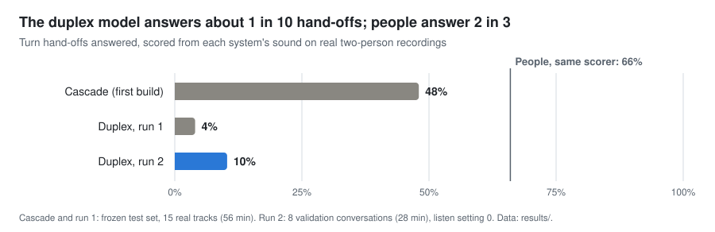
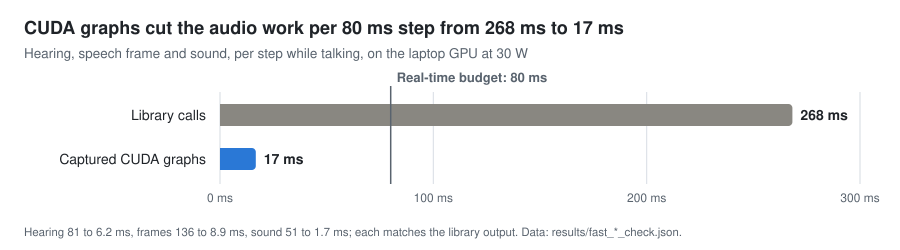
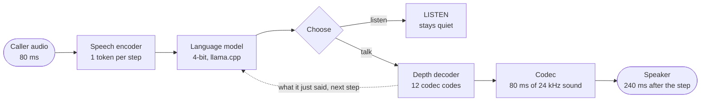

<p align="center">
  <picture>
    <source media="(prefers-color-scheme: dark)" srcset="docs/assets/banner-dark.svg">
    
  </picture>
</p>

<p align="center">
  
  
  
  
  
</p>

<p align="center">
  <a href="paper/REVIEW.md"><b>Review paper</b></a> ·
  <a href="#results">Results</a> ·
  <a href="#how-it-works">How it works</a> ·
  <a href="#what-went-wrong-and-what-it-taught">Lessons</a> ·
  <a href="#repository-map">Repository map</a> ·
  <a href="#rebuilding">Rebuild</a>
</p>

Alba is an attempt to build a private, offline voice assistant that **listens and talks at the same time**, like
a person on a phone call, on one consumer laptop. LFM3-Audio-2B (Liquid AI) was fine-tuned with 4-bit QLoRA into a
single streaming model that makes one decision every 80 ms. Turn-taking, "mm-hm"s and giving way are learned from
real two-person recordings, not written as rules.

> [!NOTE]
> **Paused and unfinished (5 November 2026).** The engineering works; the conversation does not yet, and none of
> the project's eight acceptance checks is met. The [review paper](paper/REVIEW.md) explains why, and the fixes are
> in the code, ready for the next training run.

## At a glance

| Working | Not yet |
| --- | --- |
| Runs at **0.30× real time** on an RTX 3050 Laptop (4 GB, 30 W) | Answers **10%** of turn hand-offs with real voices; people answer 66% |
| Its speech says what it planned: **87%** of the words are heard back | Can be rude: in a live test it said "you're a weird person" |
| Frozen held-out tests, with every decision rule written before its results | Feeling, knowledge and safety not yet scored for the duplex model |
| Local tool API on 127.0.0.1 passes **17 of 17** checks | Tool calls by voice are built and tested in code, but not trained |

## Results

<picture>
  <source media="(prefers-color-scheme: dark)" srcset="docs/assets/answered-dark.svg">
  
</picture>

Every system is scored from its own sound, the way a listener hears it, so even people top out at 66% here. The
cascade answered more often but slowly (1.65 s median); the duplex model starts fast but mostly says "yeah".

<picture>
  <source media="(prefers-color-scheme: dark)" srcset="docs/assets/speed-dark.svg">
  
</picture>

Each GPU launch costs 36 to 70 µs under Windows' graphics driver, and the audio parts made hundreds per step.
Hand-written fixed-shape steps, captured once as CUDA graphs, turned 268 ms into 17 ms, matching the library's own
output. Full tables are in [section 6 of the paper](paper/REVIEW.md#6-results).

## How it works



- **One decision every 80 ms.** The model hears one token of the caller, then stays quiet, starts talking (a few
  planned words, then sound), or keeps talking. Plan words run ahead of the sound, 6 for every 12 frames.
- **Honest timing.** Sound made at a step plays 240 ms after the step began, and training shifts Alba's speech by
  the same amount, so the model learns the moments real people chose, as a listener hears them.
- **Split for speed.** llama.cpp runs the 4-bit language model, fed only vectors; PyTorch runs hearing, frames and
  sound as captured CUDA graphs (`app/fast_audio.py`).
- **Learned, not ruled.** Data comes from real recordings re-spoken in Alba's voice, synthetic calls, tone-of-voice
  clips and remarks to ignore, with echo and laptop-microphone sound mixed in.

## What went wrong, and what it taught

None of these showed in the training loss. Most were found by logging the model's individual decisions, and each
is fixed in the code ([paper, section 7](paper/REVIEW.md#7-failure-analysis)).

1. **An untrainable "speak now" token.** The marker after each plan chunk is a placeholder whose embedding was
   never trained, so the model could not predict it and the runtime filled the gap with junk words. Chunks now end
   by count, as the model's own mode does.
2. **Real voices only taught "yeah".** Real speakers' long turns were context only, so with a real voice Alba learned
   just "mm-hm"s and echoes: 107 "Yeah."s in 2.6 minutes. New words are now written for Alba in every real turn.
3. **A stop rule that over-stops.** The frame sampler draws four codebooks at once and stops on any end code,
   about four times the model's own chance of stopping mid-sentence. A one-codebook option is ready, with its
   adoption rule fixed in advance.
4. **A memory path that could never run.** llama.cpp cannot rewind this model's convolution state to a middle
   position, so long calls would have crashed after about 18 minutes. It now clears and replays.

The general lesson: log decisions, not just losses, and validate on real speech.

## Related work

Alba is small next to the open full-duplex models, and learns from them:
[Moshi](https://github.com/kyutai-labs/moshi) (the reference design, 7.7B),
[PersonaPlex](https://github.com/NVIDIA/personaplex) (strongest open turn-taking, 7B),
[Voice Activity Projection](https://github.com/ErikEkstedt/VoiceActivityProjection) (learned turn-taking),
[LoopSpeech](https://github.com/FreedomIntelligence/LoopSpeech) (models listening to themselves), and
[Full-Duplex-Bench](https://github.com/DanielLin94144/Full-Duplex-Bench) (a shared benchmark). The full list, with
what each can teach this project, is in [docs/related-work.md](docs/related-work.md).

## Contributing

Feedback, issues and pull requests are welcome; see [CONTRIBUTING.md](CONTRIBUTING.md). Every change is reviewed by
the owner, and [SECURITY.md](SECURITY.md) explains how contributions are guarded against malicious code and prompt
injection.

## Repository map

| Folder | What |
| --- | --- |
| [`app/`](app/) | The runtime: `duplex.py` (the streaming duplex model), `fast_audio.py` (CUDA-graph steps), `duplex_call.py` (live call window), `api.py` (local tool API), `llama_lib.py` (ctypes bridge to llama.cpp); the rest is the earlier cascade |
| [`tools/`](tools/) | Data, training, frozen tests, scoring and diagnostics; see its [README](tools/README.md) |
| [`integrations/`](integrations/) | Two example tools: a to-do list and a read-only notes-folder search |
| [`data/tests/`](data/tests/) | Frozen held-out test definitions (item texts, sandbox) and the SHA-256 of every frozen file; no audio |
| [`results/`](results/) | Summary scores and diagnostics behind the paper; see its [README](results/README.md) |
| [`models/manifests/`](models/manifests/) | Official download sources and checksums for every model and binary |
| [`docs/`](docs/) | The [lab notebook](docs/lab-notebook.md), the goal definition and the plans; see its [README](docs/README.md) |
| [`paper/`](paper/) | The [review paper](paper/REVIEW.md) |

Left out on purpose: model weights (re-fetched from official sources and checked), datasets (from their official
hosts), and every recording (the owner's calls stay private; Block's Dessa demos were used for measurement only).

## Rebuilding

Windows 11, Git Bash, and an NVIDIA GPU with 4 GB or more.

```bash
source tools/env.sh && uv sync && bash tools/fetch_models.sh   # app environment, models, llama.cpp b12094
```

The training environment (`.venv-train`) uses Python 3.12 and [`requirements-train.txt`](requirements-train.txt):
torch 2.15 with CUDA 13.2 wheels, transformers 5.22, peft 0.21, bitsandbytes 0.50. Then, in order: build the tests
(`tools/build_testsets.py`), make the data, train (`tools/duplex_run3.sh`), calibrate on validation
(`tools/calibrate_duplex.py`), and score on the frozen sets. The [lab notebook](docs/lab-notebook.md) records every
step as it was run.

**Downloads** ([releases](https://github.com/Echolonius/alba-duplex-research/releases)): the synthetic-voice test
clips (v0.1), and the trained adapters of runs 1 and 2 (v0.2; safetensors, for non-commercial research only).
`tools/export_alba.py` turns an adapter into the files the runtime loads.

## Licenses and credits

Code and documents: MIT ([`LICENSE`](LICENSE)). Models and data keep their own licenses: LFM3-Audio-2B and LFM2.5
(LFM Open License v1.0), Gemma 4 (Apache 2.0), Pocket TTS (CC BY 4.0), Moonshine (MIT), llama.cpp (MIT), Seamless
Interaction (CC BY-NC 4.0, Meta FAIR), RAVDESS (CC BY-NC-SA 4.0), CREMA-D (ODbL). The non-commercial data licenses
rule out commercial use of models trained on them.

The repository owner set the goal, the rules and the acceptance checks, and tested the live builds. The code, tests
and paper were written by Claude (Anthropic) as a coding agent. To cite this work, use GitHub's "Cite this
repository" button ([`CITATION.cff`](CITATION.cff)).
